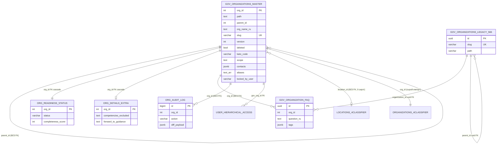

# Готовность к приёму ~27k организаций и всех их данных

Срез: 2026-10-27, Postgres 17.11, БД `eotinish_ai_demo` (225 MB, read-only: только SELECT/EXPLAIN). Код читался в `ebz-router/src`, правок нет.

## Executive summary (10 строк)

1. **Данные 27k уже в Postgres**: `platform.gov_organizations_master` = 27 164 строки (27 038 живых, 126 `deleted`), 53 MB; дерево целое, циклов нет, глубина ≤ 7, orphan'ов по `deleted`-родителю 0.
2. **Приложение «видит» 27k только на чтение** (`/api/orgs` → `src/lib/db.ts`). Дерево, роутинг (`lexicon`), аналитика готовности, MCP, jurisdiction-проверки и `lock` работают на **JSON-сторе из 581 орг** (`src/lib/store.ts`, `src/data/all_566_orgs.json`) — это другое пространство id (slug), с БД совпадают лишь 17–18 slug'ов из 32.
3. **Запись в БД есть, но только для двух операций**: `update_content` (`updateOrgContentInDb`, db.ts:250) и `reparent` (`reparentOrgInDb`, db.ts:427) + `/api/bulk` (Excel). Всё остальное (create_org, import_csv, convert_*, lock, EBZ-статьи) — только память/JSON-файл. Для ~26k орг, которых нет в JSON, `mutate` вернёт ошибку **после** успешного коммита в БД (см. §2).
4. **`version` в БД персистентна** (`master.version`, `FOR UPDATE` + сравнение) для `update_content`; для `reparent` параметр `expectedVersion` **игнорируется**. **Soft-lock — только память процесса** (колонки `locked_by_user/locked_at` в БД не пишутся) и нигде не проверяется при сохранении. **Аудит** — `platform.org_audit_log` (16 строк) + `Map` в памяти; `/api/audit` склеивает оба → дубли.
5. **Гонки**: single-org update защищён (row lock + version, аудит в той же txn). НЕ защищены: взаимный reparent (A↔B → цикл), bulk vs edit (last-write-wins), параллельные bulk (deadlock), всё, что идёт через JSON-файл при >1 инстансе/serverless (read-only FS).
6. **Качество 27k**: 183 живых орг указывают на **несуществующего** родителя (parent_id 36265, 978, 980, 14717…); 2 битых `path` (`716630/79593/`, `/73478/85977/`); `scope` заполнен у 93 из 27 038 (и это шаблонные заглушки); FAQ у 43 орг (52 записи); контакты у 3; `aliases` у 2; `kato_code` у 27 036 (2 NULL); `short_name_ru` усечён «…» у 25 027.
7. **Маршрутизируемых орг ≈ 70** (ключи `LEXICON`, 17 из них совпадают со slug'ами master) + ещё 43 с FAQ; для остальных ≈ 26.9k есть только название/тип/КАТО. Это главный блокер «все данные используются».
8. **Тест-мусор**: org 77 перезаписан QA-тестами (`scope = 'Аудит проверка полномочий …'`, version 16, 15 audit-строк), org 30400 (`test apr update`, v2); в git-tracked `all_566_orgs.json` лежат 14 junk-орг (`Hacked Backdoor Org`, `RBAC Probe Org`, …) — файл переписывается рантаймом.
9. **Вердикт**: хранение/чтение — 🟢; целостность данных — 🟡; запись/конкурентность/источник истины — 🔴; роутинг/покрытие знаний — 🔴; эксплуатация (бэкапы, миграции, мульти-инстанс) — 🟡.
10. **Что делать первым**: единый DB-слой (убрать `orgStore` из write-path), `UPDATE … WHERE version=$n`, advisory-lock + cycle-check в txn для reparent, CHECK/FK (`parent_id`), чистка 183 orphan'ов и тест-мусора, затем staged-import и `pg_trgm`/`tsvector`. План и оценки — §5.

---

## 1. Postgres: реальное состояние

### 1.1 Таблицы (схемы, связанные с оргами) и размеры

| Таблица | Строк | Размер (total) | Назначение |
|---|---:|---:|---|
| `platform.gov_organizations_master` | 27 164 | 53 MB | **главный реестр** (integer `org_id`, materialized path) |
| `incoming.organizations_4classifier` | 27 164 | 23 MB | сырой импорт классификатора (почти копия master; 7 расхождений по parent/path/deleted) |
| `incoming.locations_4classifier` | 18 498 | 5.7 MB | справочник локаций/КАТО |
| `knowledge.org_readiness_status` | 27 164 | 4.4 MB | статус наполнения; 1:1 с master |
| `knowledge.org_details_extra` | 3 | 32 kB | контакты/анти-компетенции (заполнено у 3 орг) |
| `platform.gov_organization_faq` | 52 | 128 kB | FAQ (43 орг) |
| `platform.org_audit_log` | 16 | 96 kB | аудит правок орг |
| `platform.audit_log` | 2 527 | 792 kB | общий аудит (логины/юзеры; не про орги) |
| `platform.gov_organizations` | 567 | 456 kB | **legacy 566** (uuid, slug, text-path `ap.arrfr…`) — то, что зеркалит JSON |
| `knowledge.user_hierarchical_access` | 5 | 48 kB | RBAC по `jurisdiction_path` (app им **не пользуется**: логин из `EBZ_PRESET_USERS`, `auth.ts:40`) |
| `platform.users` | 3 | 96 kB | пользователи ai-platform (не те, что в `EBZ_PRESET_USERS`) |

БД общая с ai-platform (alembic `0028`, расширения `pg_trgm`, `vector`, **нет** `ltree`). Роль `eotinish_platform` имеет UPDATE и CREATE на схему. `max_connections=100`, pool в приложении `max:10` (db.ts:8), isolation по умолчанию **READ COMMITTED**. Prod-compose: postgres:16 (dev — 17), порт БД проброшен наружу, `initdb/01_eotinish_master_27k.sql.gz` выполняется **только при первом создании тома**.

### 1.2 `platform.gov_organizations_master` — колонки

| Колонка | Тип | Null | Default |
|---|---|---|---|
| `org_id` | integer | NN | **нет sequence** (max=91705) → новые id генерировать нечем |
| `path` | text | NN | materialized path `77/30400/17862/` |
| `org_name_ru`, `org_name_kk` | text | NN / null | |
| `parent_id` | integer | null | **нет FK** |
| `not_unit_org_id` | integer | null | заполнено у всех 27 038 |
| `location_name_ru/kk`, `location_id` | text / varchar | null | |
| `org_type_ru`, `org_type_kk` | text | null | 25 типов |
| `deleted` | boolean | NN | false |
| `slug` | varchar | null | UNIQUE; задан у 32 |
| `short_name_ru`, `short_name_kk` | varchar | null | |
| `kato_code` | varchar | null | 9 знаков |
| `jurisdiction` | varchar | null | `'republican'` (у всех 27 038 — значение по умолчанию, не данные) |
| `scope`, `legal_basis` | text | null | |
| `contacts` | jsonb | null | `'{}'` |
| `version` | integer | NN | 1 |
| `is_active` | boolean | NN | true |
| `locked_by_user`, `locked_at` | varchar / timestamptz | null | **не пишутся приложением** |
| `created_at`, `updated_at` | timestamptz | null | now() — **нет триггера** на updated_at/version |
| `aliases` | text[] | null | `'{}'` |
| `show_on_frontend` | boolean | NN | true |

Остальные: `knowledge.org_readiness_status(org_id PK/FK CASCADE, status NN 'unfilled', has_human_touch NN, completeness_score NN, missing_fields text[], last_touched_by, verified_by, …)`; `knowledge.org_details_extra(org_id PK/FK CASCADE, competencies_excluded, forward_to_guidance, phone_hotline, phone_chancellery, email_official, website_url, physical_address)`; `platform.gov_organization_faq(id uuid PK, org_id int NULL, organization_id uuid FK→legacy, question_ru NN, answer_ru, tags jsonb, is_active, is_published, sort_order …)`; `platform.org_audit_log(id bigserial PK, org_id NN, action NN, user_id NN, user_name, user_role, diff_payload jsonb NN, created_at)`.

### 1.3 Ограничения и индексы (всё, что есть)

* **master**: PK `(org_id)`, UNIQUE `(slug)`. **Нет**: FK на `parent_id`, CHECK'ов, триггеров, UNIQUE по `(parent_id, нормализованное имя)`, ограничения «ровно один корень», индекса по `deleted`, trgm/tsvector по именам.
* Индексы master: `idx_gov_master_path (path varchar_pattern_ops)` — 2.3 MB, `idx_gov_master_parent`, `idx_gov_master_type`, PK, slug_key.
* `org_readiness_status`, `org_details_extra`: FK → master `ON DELETE CASCADE`.
* `org_audit_log`: **нет FK** на master (осознанно или нет — аудит переживёт удаление), индексы `(org_id)`, `(created_at DESC)`.
* `gov_organization_faq`: индекс `idx_faq_org_id (org_id)`; FK только на legacy-таблицу по `organization_id`; **нет FK `org_id → master`**, нет UNIQUE.
* EXPLAIN: `ILIKE '%школа%'` по имени/short/aliases → **Seq Scan, 75 ms** на 27k (7 626 совпадений); `path LIKE '77/30400/12102/%'` → Index Only Scan, **0.5 ms** на 1 301 поддерево; дефолтный листинг с подсчётом детей — 2.5 ms (≈325 строк). Search приемлем сейчас, не масштабируется на конкурентную нагрузку без trgm.

### 1.4 ER-диаграмма



### 1.5 Примеры строк (по 5 на ключевую таблицу; тексты сокращены, это публичные данные ведомств, ПДн нет)

`master`:

| org_id | parent_id | path | short_name_ru | org_type_ru | kato_code | slug | version |
|---:|---:|---|---|---|---|---|---:|
| 77 | NULL | `77/` | АП | Администрация Президента | 711210000 | ap | **16** |
| 30400 | 77 | `77/30400/` | АПр | Аппарат Правительство РК | 711210000 | gov | **2** |
| 17862 | 30400 | `77/30400/17862/` | Минэнерго РК | Министерство | 711210000 | minenergo | 1 |
| 12102 | 30400 | `77/30400/12102/` | Акимат Актюбинской обл. | Акимат области/города респ значения | 151011100 | — | 1 |
| 88244 | 17856 | `77/17856/88244/` | Кассационный суд РК | Судебный орган | 711310000 | — | 1 |

`org_readiness_status`: (88244, unfilled, false, 15, `{scope,faq,contacts,org_name_kk}`), (17862, in_progress, true, 75, `{scope,faq,contacts,org_name_kk}`), (77, in_progress, true, 75, last_touched_by «Супер-администратор (АП РК)»), (30400, in_progress, true, 75), (17978, in_progress, true, 65, `{competencies_excluded}`). Статусов всего два: `unfilled` 27 160, `in_progress` 4.

`org_details_extra` (всего 3 строки, org 17978 / 30400 / ещё одна): `phone_hotline=1414`, `phone_chancellery=+7 (7172) …`, `email_official=…@…gov.kz`, `competencies_excluded`, `forward_to_guidance`.

`gov_organization_faq`: (org 77 «Помилование и гражданство», tags `[помилование, гражданство, указ]`), (77 «Жалобы на министров и акимов»), (17875 «Кредиты и действия коллекторов», tags `[кредит, мфо, коллектор, …]`), (17850 «Государственная служба и этика»), (36946 «Дорожная безопасность и Сергек»). Больше всего FAQ у одной орг — 3.

`org_audit_log` (16 строк): 15 × (org 77, `update_content`, `user-superadmin`, scope=`Аудит проверка полномочий <timestamp>`, version 2→16, 2026-10-27 10:15–10:30) + 1 × (org 30400, `user-curator-apr`, `test apr update`). То есть **аудит содержит только QA-прогоны**.

`user_hierarchical_access`: admin_ap (77, `77/`), curator_apr (30400, `77/30400/`), editor_minenergo (17978, `77/30400/17978/`), editor_mvd (17860), editor_kaen (17980, роль `operator`).

---

## 2. Источник истины: JSON/память vs Postgres

### 2.1 Карта путей

| Операция | Файл:строка | Читает | Пишет | Итог |
|---|---|---|---|---|
| Список/поиск/дети `GET /api/orgs` | `api/orgs/route.ts:16-29` | **DB** (`getOrgsFromDb`), fallback на `orgStore` при исключении или **пустом** ответе | — | DB первичен; пустой результат (например поиск без совпадений) тихо отдаёт **JSON-данные другого пространства id** (route.ts:32-110, `source:'verified_hierarchy'`) |
| Карточка | `orgs/route.ts:17-19` → `db.ts:185` | DB | — | |
| `lock` / `unlock` | `mutate/route.ts:101-112` → `store.ts:acquireLock` | **память** | память | для DB-only орг: «Организация не найдена», ответ **423** |
| `update_content` | `mutate/route.ts:114-180` | DB (txn) затем память | DB **и** память | см. 2.2 |
| `reparent` | `mutate/route.ts:197-212` | DB затем память | DB и память | см. 2.2 |
| `create_org` | `mutate/route.ts:214-220` → `store.ts:createOrg` | память | **только память + `all_566_orgs.json`** | в БД не попадает; id `org-<ms>-<rand4>` |
| `import_csv` | `mutate/route.ts:222-228` → `store.ts:bulkImport` | память | **только память**, `persistToDisk` не вызывается → теряется при рестарте | |
| `convert_dept_to_org` / `convert_org_to_dept` | `mutate/route.ts:182-195` | память | память + JSON-файл | в БД не попадает; второе **удаляет** орг из памяти |
| Excel-импорт `POST /api/bulk` | `bulk/route.ts:174-396` | DB | **DB** (master, readiness, details_extra, org_audit_log), память **не** трогается | единственный честный DB-write-path для 26k |
| Excel-экспорт `GET /api/bulk` | `bulk/route.ts:57-168` | DB, fallback на orgStore (только если БД упала) | — | `LIMIT` по умолчанию 500 |
| Вопросы `/api/questions` | `questions/route.ts` | — | — | stateless: парсит Excel → клиент потом шлёт `update_content` с `questions` |
| ЕБЗ-статьи `/api/ebz` | `ebz/route.ts:7-37,93-180` | **JSON** `src/data/ebz_articles.json` (кэш в памяти процесса) | JSON | БД не используется вообще; ключ `orgId` — id из JSON-пространства |
| Аудит `GET /api/audit` | `audit/route.ts:13-17` | DB `org_audit_log` **+** память | — | `[...memory, ...db]` → дубли одной правки |
| Аналитика готовности | `analytics/readiness/route.ts:17` | **orgStore** (581 орг) | — | не отражает 27k и БД |
| Конфликты | `analytics/conflicts/route.ts:84` | DB (по списку из 70-ish id) | — | |
| MCP | `mcp/route.ts:130` | **orgStore** | — | LLM-агент видит 581 орг, не 27k |
| Роутинг | `lib/routing/engine.ts` + `lexicon.ts` | **orgStore** + `LEXICON` (70 ключей-slug'ов) + `geo.ts` читает DB (`kato_code`, акиматы) | — | 17 из 70 ключей совпадают с `master.slug`; остальные 53 — только в JSON/legacy |
| Права ORG_ADMIN | `auth.ts:182-250` `canUserManageOrg(user, id, orgStore.getAll())` | **orgStore** | — | для DB-only орг `targetOrg` не найден → «вне юрисдикции». Т.е. методолог ведомства **не сможет править** подчинённые из 27k, GLOBAL_ADMIN — сможет (ранний return, auth.ts:201) |

### 2.2 Где расходятся и что происходит с правками

Пространства id **разные**: JSON/legacy — slug (`ap`, `arrfr`, `banki-mfo`; 566 в `platform.gov_organizations`, 581 в JSON с 14 junk-орг), master — `org-<int>` либо один из 32 slug'ов. В `LEXICON` 70 ключей: 70 есть в legacy, 17 — в master.

1. **`update_content` для DB-only орг (`org-17862` и т.п.)**: `updateOrgContentInDb` коммитит (db.ts:411), затем `orgStore.updateContent` → «Организация не найдена» → HTTP **409** (mutate:176-178). Пользователь видит ошибку, БД уже изменена, `version` в БД +1 → следующая попытка с прежним `version` даст реальный конфликт. (Проверено по коду; вживую не прогонял — запись запрещена.)
2. **`update_content` для орг, присутствующей в обоих** (`ap`, `gov`, `minenergo`…): версии независимы (DB: org 77 → v16; JSON `version` из файла). Клиент получает версию из `/api/orgs` (DB), память сравнивает со своей → вероятен ложный 409 «Конфликт версий» при **уже зафиксированной** DB-записи. Если же DB вернула `success:false` (конфликт версий), код её **игнорирует** (`dbResult` не проверяется, mutate:119-145) и берёт результат памяти → ответ 200 при **ненаписанной** БД. Две системы могут и «успешно» разойтись.
3. **Исключение в DB** (`catch`, mutate:143, 202) проглатывается → правка уходит только в память и JSON-файл, пользователь не знает.
4. **Что в DB вообще не сохраняется из `update_content`**: `theme`, `departments`, `status`, `katoCode`, `katoNameRu`, `locationId`, `hasHumanTouch`, `llmNotes` (есть только в `store.updateContent`). Статус принудительно `in_progress`, `completeness_score=75` при **любом** сохранении (db.ts:345-352), независимо от реальной заполненности. `org_details_extra` пишется через `COALESCE(EXCLUDED, old)` → поле нельзя очистить; `questions` — `DELETE` всех FAQ + `INSERT` заново (db.ts:335-341), история FAQ не хранится.
5. **`reparent`**: `reparentOrgInDb` **не использует `expectedVersion`** (параметр `_` не читается), `FOREIGN KEY` на parent нет. Память отдельно проверяет циклы по своему дереву — для DB-only орг вернёт «Организация не найдена» → 400 после коммита.
6. **`create_org`** создаёт запись только в JSON-сторе и **переписывает git-tracked файл** (`store.ts:46-58`). Для 27k это значит «новая орг не существует в БД»: не видна `/api/orgs` (DB-ветка), не попадает в роутинг/аудит БД. id вида `org-1793095983539-972i` при чтении через `getOrgByIdFromDb` превращается в `parseInt('1793095983539-972i')` = 1.79e12 → выходит за int4 → ошибка PG, поглощённая `catch` (db.ts:241-244) → `null`.
7. **Регулярка-баг** `db.ts:114` и `db.ts:133`: `/^\\d+$/` в TS-литерале — это «обратный слеш + d», а не цифры. Поэтому `?id=org-123` → в SQL уходит строка `'org-123'` на `m.org_id = $1` → ошибка приведения типа; `?parent_id=17862` идёт в slug-ветку и возвращает пусто; сработает лишь fallback на JSON. Требует проверки вживую, но по коду числовая ветка в `getOrgsFromDb` недостижима. (Плюс `bulk/route.ts:264` использует корректный `/^\d+$/`.)

### 2.3 Что переживает рестарт / несколько инстансов / serverless

| Состояние | Где живёт | Рестарт | N инстансов | Serverless (read-only FS) |
|---|---|---|---|---|
| `master.version` (optimistic lock) | **БД** | ✅ | ✅ (row lock) | ✅ — но только для `update_content` через DB |
| Память `org.version` (JSON-стор) | процесс + `all_566_orgs.json` | ⚠ только если `persistToDisk` вызван (не вызывается в `bulkImport`, `acquireLock`) | ❌ каждый инстанс свой экземпляр; последний `rename` затирает остальных | ❌ запись падает с `console.warn`, правка живёт до холодного старта |
| **Soft lock** (`lockedBy`) | **память** (поле объекта); в БД `locked_by_user/locked_at` существуют, но **не пишутся** (db.ts лишь очищает их и читает на :67) | ❌ теряется | ❌ у каждого инстанса свой замок | ❌ |
| Soft lock — **принуждение** | нигде: `updateContent`/`updateOrgContentInDb` не проверяют `lockedBy` → чисто «подсказка UI», TTL 120 с (`store.ts:acquireLock`) | | | |
| **Audit** | `platform.org_audit_log` — для DB-путей (`update_content`, `reparent`, `bulk`) ✅; `orgStore.auditLogs` (Map) — для всех правок через память ❌ теряется | DB ✅ / mem ❌ | DB ✅ / mem ❌ | то же |
| EBZ-статьи | JSON-файл + кэш процесса | ✅ (файл) | ❌ stale-кэш + lost update | ❌ |
| `create_org`, `import_csv`, `convert_*` | память + JSON | частично | ❌ | ❌ |

**Вывод по вопросу «есть ли ВООБЩЕ write-path в Postgres для правок орг»: да, ровно три** — `updateOrgContentInDb`, `reparentOrgInDb`, `/api/bulk` POST. Нет пути для: создания орг, удаления/soft-delete (`deleted` вообще не пишется приложением), конвертации отдел↔орг, ЕБЗ-статей, lock'ов, прав доступа. `knowledge.user_hierarchical_access` не используется.

---

## 3. Гонки (race conditions)

Контекст: PG isolation = READ COMMITTED, pool 10 соединений, N Next-инстансов допустимо.

| # | Сценарий | Текущее поведение | Защищено? | Исправление |
|---|---|---|---|---|
| 1 | **Два редактора одной карточки (DB-путь)** | `SELECT … FOR UPDATE` + `version !==` (db.ts:285-298), UPDATE с `version=version+1`, аудит и FAQ в той же txn. Второй ждёт, затем получает «Конфликт версий». | ✅ для БД. ❌ на уровне ответа API: JSON-стор может дать ложный 409 или «успех» при проигрыше в БД (§2.2) | Убрать вторую систему; единый ответ из DB. Упростить до `UPDATE … SET version=version+1 WHERE org_id=$1 AND version=$2 RETURNING *` (0 строк → 409), без `SELECT FOR UPDATE`; аудит `INSERT … SELECT` в той же txn. |
| 2 | **Две правки в JSON-стор (память)** | Проверка `org.version !== expected` и мутация синхронные (нет `await` между ними) → внутри **одного процесса** атомарно. Между инстансами — нет. `persistToDisk` пишет весь файл (сегодня 0.8 MB; при 27k ≈ 40–60 MB, sync на event loop) | ✅ 1 процесс / ❌ N процессов, lost update; сериализация всего файла при каждой правке | Не масштабировать JSON; вывести из write-path (§5). |
| 3 | **Reparent A под B и B под A одновременно → цикл** | Txn1: `FOR UPDATE` только на A, читает `path` B **без блокировки** (db.ts:481-486), проверка `parentPath.startsWith(oldPath)`. Txn2 симметрично. Обе проверки проходят на старых данных; в итоге `A.parent=B`, `B.parent=A`, `path` потомков «разъезжается». Плюс `expectedVersion` не проверяется, в корень (`parent_id NULL`) можно создать второй корень. | ❌ | Внутри txn: `SELECT pg_advisory_xact_lock(hashtext('org_tree'))` (глобальный лок на изменение структуры — структурные правки редки), затем recursive-CTE проверка: `WITH RECURSIVE anc AS (SELECT org_id,parent_id FROM master WHERE org_id=$newParent UNION ALL SELECT m.org_id,m.parent_id FROM master m JOIN anc ON m.org_id=anc.parent_id) SELECT 1 FROM anc WHERE org_id=$moved` → отказ. + `WHERE version=$n RETURNING`. + FK `parent_id` и CHECK `parent_id<>org_id`. Альтернатива: constraint-триггер на `parent_id/path`. |
| 4 | **Reparent + одновременный edit ветки** | Reparent обновляет `path` всех потомков по `LIKE`, без их блокировки и без bump `version` у потомков; edit потомка читает старый `path` (если его проверка прав по нему) | ❌ | Блокировать поддерево `SELECT … WHERE path LIKE $old% ORDER BY org_id FOR UPDATE` (порядок избегает deadlock) либо глобальный advisory-lock из #3; bump `version` потомкам. |
| 5 | **Удалить родителя, пока создаётся дочерний** | Удаления в БД из приложения нет (`deleted` не пишется). `create_org` — только память: проверки существования родителя нет, parent может быть уже `convert_org_to_dept`-удалён (`orgs.delete`) → «висячий» child в JSON. В БД FK на `parent_id` отсутствует → можно вставить сироту/ссылку на `deleted=true`. | ❌ | FK `parent_id → master(org_id)`; создание: `INSERT … SELECT … FROM master p WHERE p.org_id=$parent AND NOT p.deleted FOR SHARE` (блокирует удаление родителя); soft-delete: `UPDATE … SET deleted=true WHERE org_id=$1 AND NOT EXISTS (SELECT 1 FROM master c WHERE c.parent_id=$1 AND NOT c.deleted)` в одной txn с `FOR UPDATE` родителя. |
| 6 | **Параллельные импорты (Excel `/api/bulk`)** | Одна txn на файл (≤ 5000 строк); построчно `UPDATE` без проверки `version` → last-write-wins, **затирает** свежие ручные правки, молча делает `version+1`. Два импорта с пересекающимися org_id в разном порядке → взаимная блокировка строк → PG убьёт одну txn (deadlock 40P01), клиент получит 500. Валидные строки коммитятся даже при `errorsCount>0` (частичное применение, `COMMIT` на bulk:375 всегда). Идемпотентности нет — повторная отправка файла = ещё один `version+1` и ещё `bulk_excel_import` в аудите. `import_csv` в `mutate` — другой путь (только память, без блокировок). | ❌ | Файл → `staging` + `import_batch(id, sha256, status)` с `UNIQUE(sha256)` (idempotency key); применять одним `UPDATE … FROM staging WHERE m.version = staging.expected_version`; сортировка по `org_id`, `pg_advisory_xact_lock(batch)`; режим «всё или ничего» либо отчёт; `ON CONFLICT` по `(batch_id,row_no)`. |
| 7 | **Истечение soft-lock** | TTL 120 с вычисляется при следующем `acquireLock` (store.ts), heartbeat нет; замок не проверяется при сохранении; при рестарте/другом инстансе исчезает. Редактор A может сохранять после того как замок взял B. | ❌ (лишь UI-подсказка) | Колонки уже есть: `UPDATE master SET locked_by_user=$u, locked_at=now() WHERE org_id=$1 AND (locked_by_user IS NULL OR locked_by_user=$u OR locked_at < now()-interval '2 min') RETURNING *` (атомарно, 0 строк → 423); save проверяет `locked_by_user=$u` **и** `version`; отдельный `POST /lock/heartbeat`. Оптимистичный `version` остаётся главным механизмом, lock — UX. |
| 8 | **read-then-write версии без txn** | В `store.ts` — внутри одного тика синхронно, ок для 1 процесса. В `ebz/route.ts:127-161` — аналогично, **но** проверка пропускается если `article.version` или `existing.version` `undefined` (:134-136) → любой клиент без версии перезаписывает. DELETE без версии вовсе. | ⚠ | Обязательная версия (`If-Match`/`WHERE version=$n`), перенос ЕБЗ в таблицу `ebz_article` с `version`. |
| 9 | **Аудит и данные в разных транзакциях** | DB-пути: аудит в той же txn ✅ (db.ts:403-411, bulk). Память: `appendAudit` в `Map` ❌. После `COMMIT` `getOrgByIdFromDb` читает вне txn — безвреден. | ⚠ | Единый `audit_log` в той же txn (+ `before/after` jsonb, `request_id`, `idempotency_key`); читать только из БД (убрать merge с памятью → пропадут дубли). |
| 10 | **Дубли при `create_org`** | Нет проверки одноимённой орг у того же parent, id по `Date.now()` (коллизия при 2 запросах в одну мс практически исключена за счёт rand4, но не гарантирована) | ❌ | `UNIQUE (parent_id, lower(btrim(org_name_ru))) WHERE NOT deleted`, id из sequence (`CREATE SEQUENCE … START 100000`), idempotency-key на POST. |

Прочее: SERIALIZABLE не нужен — достаточно advisory-lock на структурные операции + `version`-CAS на контентные.

---

## 4. Качество данных 27k (SQL, `deleted = FALSE`, 27 038 орг)

| Проверка | Результат | Оценка |
|---|---|---|
| Всего / живых / deleted | 27 164 / 27 038 / 126 (119 `is_active=false`, 7 `is_active=true`) | 🟢 (7 несогласованных флагов) |
| Корни (`parent_id IS NULL`) | 1 (org 77) | 🟢 |
| **Орфаны: parent_id → нет такой строки** | **183** (родители 36265×33, 978×31, 980×25, 14717×25, 69545×21, 30189×19, 977×10, 983×5, 2280, 1062 …) | 🔴 |
| Дети удалённых родителей | 0 | 🟢 |
| Self-parent | 0 | 🟢 |
| **Циклы** (recursive CTE) | 0; макс. глубина 6 по parent-цепочке | 🟢 |
| Глубина по `path` | d1:1, d2:282, d3:642, d4:2 439, d5:10 947, d6:12 716, d7:11 | 🟢 |
| **Битый `path`** (`path ≠ parent.path || org_id || '/'`) | **2**: org 79593 (`716630/79593/`, родитель 16630 с path `77/30400/2700/2759/16630/`), org 85977 (`/73478/85977/`) — подозрение на ручную правку/ошибочный импорт 2026-10-14 (оба `version=1`, `updated_at` позже `created_at`). Эти же строки отличаются от `incoming` | 🟡 |
| Рассинхрон `incoming.organizations_4classifier` ↔ master | 7 строк с отличиями parent/path/deleted | 🟡 |
| Дубли: тот же parent + нормализованное имя | 6 групп / 12 строк (max 2) | 🟡 |
| Дубли глобально по имени | 25 имён / 52 строки | 🟢 (много нормальных: «Ясли-сад …» в разных районах) |
| Junk/test по regex (`тест|test|dummy|заглушк|не использ|дубл`) | 23 совпадения, почти все легитимны («Национальный центр тестирования», «Департамент Комитета по регулированию…»); **реальный junk — в JSON и правках QA, не в БД** | 🟡 |
| Пробелы/двойные пробелы в `org_name_ru` | 1 991 | 🟡 |
| `short_name_ru` усечён «…» (генерация из полного имени) | 25 027 (92.6 %) | 🟡 для UI/поиска |
| NULL `org_name_kk` | 0; но `org_name_kk = org_name_ru` у 22 | 🟢 |
| `kato_code` | заполнен 27 036 (все 9 знаков), NULL 2; 20 префиксов регионов; 4 693 distinct кодов | 🟢 (но КАТО — адрес **здания**, не зона ответственности; у `org 77` и `org 12102` стоит КАТО Астаны/района — см. `geo.ts`) |
| `location_id` без записи в `locations_4classifier` | 0 | 🟢 |
| `jurisdiction` | у всех `republican` (default, не данные) → поле бесполезно для фильтра региональных/районных | 🔴 для логики |
| **Level/type consistency** (`mapDbRowToGovOrg`, db.ts:18-28 вычисляет level из `org_type_ru`) | central 26, agency 71, regional 2 982 (в т.ч. всё «Управление/Отдел Акимата» 2 956 → попадает в `regional`, хотя это отделы районных акиматов), district 23 959. Колонки `level` в БД нет — класс вычисляется эвристикой по подстроке | 🟡 |
| Все 24 «Министерства» имеют parent | да | 🟢 |
| `scope` заполнен | 93 / 27 038; большинство — шаблон «Сфера деятельности и полномочия ведомства: <имя>» или просто имя | 🔴 |
| `legal_basis`, `contacts` | 0 / 27 038 заполнено | 🔴 |
| `aliases` | 2 | 🔴 |
| `org_details_extra` (контакты/анти-компетенции) | 3 строки | 🔴 |
| FAQ | 43 орг, 52 записи; `org_id` без FK | 🔴 |
| `readiness`: `unfilled` | 27 160, `in_progress` 4 (avg score 15 / 73) | отражает реальность |
| `slug` | 32 (0.1 %); нужен только для «верхних» | 🟢 |
| **Маршрутизируемые** | `LEXICON` 70 ключей (в master соответствуют 17 по slug, остальные только в legacy/JSON) + 43 орг с FAQ; **≈ 0.3 % реестра** | 🔴 |
| Листья (нет детей) | 24 906 (92 %), макс. детей у одной орг 513, >200 детей у 5 | 🟢 (нужен постраничный/lazy UI) |

Воспроизводимые запросы (главные):

```sql
-- орфаны
SELECT m.parent_id, count(*) FROM platform.gov_organizations_master m
WHERE NOT m.deleted AND m.parent_id IS NOT NULL
  AND NOT EXISTS (SELECT 1 FROM platform.gov_organizations_master p WHERE p.org_id = m.parent_id)
GROUP BY 1 ORDER BY 2 DESC;                       -- 183 строк

-- несогласованный path
SELECT c.org_id, c.path, p.path AS parent_path
FROM platform.gov_organizations_master c
JOIN platform.gov_organizations_master p ON p.org_id = c.parent_id
WHERE c.path <> p.path || c.org_id || '/';        -- 79593, 85977

-- циклы
WITH RECURSIVE t AS (
  SELECT org_id, parent_id, 1 d, ARRAY[org_id] seen
  FROM platform.gov_organizations_master WHERE NOT deleted AND parent_id IS NOT NULL
  UNION ALL
  SELECT t.org_id, m.parent_id, d+1, seen||m.org_id
  FROM t JOIN platform.gov_organizations_master m ON m.org_id = t.parent_id
  WHERE m.parent_id IS NOT NULL AND NOT m.org_id = ANY(seen) AND d < 30)
SELECT max(d) FROM t;                              -- 6, циклов нет

-- дубли parent+имя
SELECT parent_id, lower(regexp_replace(org_name_ru,'\s+',' ','g')) n, array_agg(org_id)
FROM platform.gov_organizations_master WHERE NOT deleted
GROUP BY 1,2 HAVING count(*) > 1;                 -- 6 групп

-- покрытие знаний
SELECT count(*) FILTER (WHERE scope IS NOT NULL AND btrim(scope)<>'') scope,
       count(*) FILTER (WHERE EXISTS (SELECT 1 FROM platform.gov_organization_faq f WHERE f.org_id=m.org_id AND f.is_active)) faq,
       count(*) FILTER (WHERE EXISTS (SELECT 1 FROM knowledge.org_details_extra e WHERE e.org_id=m.org_id)) extra
FROM platform.gov_organizations_master m WHERE NOT deleted;
```

---

## 5. План адаптации

### 5.1 Целевая схема (эволюция существующей, а не новая БД)

Принципы: master остаётся единственным источником истины; JSON/legacy-566 → **seed/справочник маппинга slug↔org_id**, не рабочее хранилище; всё изменяемое версионируется строкой и логируется в той же txn.

```sql
-- 1. целостность дерева
ALTER TABLE platform.gov_organizations_master
  ADD CONSTRAINT fk_gov_master_parent FOREIGN KEY (parent_id) REFERENCES platform.gov_organizations_master(org_id) NOT VALID,
  ADD CONSTRAINT ck_gov_master_not_self CHECK (parent_id IS DISTINCT FROM org_id),
  ADD CONSTRAINT ck_gov_master_path CHECK (path ~ '^([0-9]+/)+$');
-- после очистки 183 орфанов и 2 path:  ALTER TABLE … VALIDATE CONSTRAINT fk_gov_master_parent;
CREATE UNIQUE INDEX uq_gov_master_one_root ON platform.gov_organizations_master ((true)) WHERE parent_id IS NULL AND NOT deleted;
CREATE UNIQUE INDEX uq_gov_master_sibling_name ON platform.gov_organizations_master (parent_id, lower(btrim(org_name_ru))) WHERE NOT deleted;  -- после мерджа 6 дублей
CREATE SEQUENCE platform.gov_org_id_seq START 100000;      -- max(org_id)=91705
ALTER TABLE platform.gov_organizations_master ADD COLUMN level smallint, ADD COLUMN deleted_at timestamptz, ADD COLUMN deleted_by varchar, ADD COLUMN depth smallint GENERATED ALWAYS AS (cardinality(string_to_array(trim(both '/' from path),'/'))) STORED;
-- триггер: BEFORE UPDATE → updated_at=now(); (опц.) version=OLD.version+1, если не задан явно

-- 2. дерево: достаточно текущего materialized path (+ varchar_pattern_ops индекс, 0.5 ms на поддерево); ltree/closure НЕ нужны при глубине ≤7 и 27k строк.
--    Если нужен «все предки» без LIKE: CREATE EXTENSION ltree + generated column, но требует прав суперпользователя и согласования с ai-platform.

-- 3. поиск
CREATE INDEX idx_gov_master_name_trgm ON platform.gov_organizations_master USING gin (org_name_ru gin_trgm_ops) WHERE NOT deleted;
CREATE INDEX idx_gov_master_short_trgm ON platform.gov_organizations_master USING gin (short_name_ru gin_trgm_ops) WHERE NOT deleted;
ALTER TABLE platform.gov_organizations_master ADD COLUMN search_tsv tsvector
  GENERATED ALWAYS AS (to_tsvector('russian', coalesce(org_name_ru,'')||' '||coalesce(scope,'')||' '||coalesce(array_to_string(aliases,' '),''))) STORED;
CREATE INDEX idx_gov_master_tsv ON platform.gov_organizations_master USING gin (search_tsv);
CREATE INDEX idx_gov_master_alive ON platform.gov_organizations_master (org_id) WHERE NOT deleted;

-- 4. знания: компетенции и ключевые слова — в БД, а не в LEXICON.ts
CREATE TABLE knowledge.org_competency (
  id bigserial PRIMARY KEY, org_id int NOT NULL REFERENCES platform.gov_organizations_master(org_id) ON DELETE CASCADE,
  lang char(2) NOT NULL, term text NOT NULL, weight smallint NOT NULL DEFAULT 1, local boolean NOT NULL DEFAULT false,
  source varchar NOT NULL, version int NOT NULL DEFAULT 1, UNIQUE (org_id, lang, term));
ALTER TABLE platform.gov_organization_faq ADD CONSTRAINT fk_faq_org FOREIGN KEY (org_id) REFERENCES platform.gov_organizations_master(org_id) ON DELETE CASCADE;

-- 5. аудит
ALTER TABLE platform.org_audit_log ADD COLUMN before jsonb, ADD COLUMN after jsonb, ADD COLUMN request_id text, ADD COLUMN idempotency_key text, ADD COLUMN batch_id bigint;
CREATE UNIQUE INDEX uq_org_audit_idem ON platform.org_audit_log (idempotency_key) WHERE idempotency_key IS NOT NULL;
-- + REVOKE UPDATE, DELETE ON platform.org_audit_log FROM eotinish_platform;  (append-only)

-- 6. замки
-- locked_by_user/locked_at уже есть; heartbeat-эндпоинт; сохранение требует (locked_by_user=$u OR NULL) AND version=$n.
```

Почему не closure/ltree: путь уже есть, глубина ≤ 7, поддерево 1 300 строк находится за 0.5 ms; reparent поддерева ≈ N `UPDATE` в одной txn под advisory-lock. Closure table оправдана, только если появятся массовые запросы «все предки/потомки» с аналитикой по сотням тысяч строк.

### 5.2 Staged import (для дальнейших выгрузок классификатора и Excel)

1. `incoming.organizations_4classifier` уже играет роль raw-слоя; добавить `import_batch(id, source, sha256 UNIQUE, status, started_at, finished_at, stats jsonb)` и `staging.org_import(batch_id, row_no, …, error text)`.
2. Валидация SQL-ом по staging: орфаны, циклы (recursive CTE), `path`-консистентность, дубли (parent+имя), обязательные поля, формат КАТО (`^\d{9}$`), `parent_id` существует ИЛИ есть в этой же партии. Результат — `import_report` (кол-во ошибок по типам, топ-50).
3. **Dry-run** = полная валидация + `diff`-отчёт (insert/update/delete/no-op) без записи; сейчас dry-run в `/api/bulk` всё равно открывает txn и COMMIT'ит.
4. Применение: одна txn, `pg_advisory_xact_lock(batch_id)`, `INSERT … ON CONFLICT (org_id) DO UPDATE … WHERE master.version = staged.expected_version OR master.updated_by_batch IS NOT DISTINCT FROM …`, аудит одним `INSERT … SELECT`.
5. Откат: перед применением `CREATE TABLE backup.master_<batch> AS SELECT … WHERE org_id IN (staged)` (или логическая копия из `before` в аудите) + `batch_id` на каждой строке аудита → «rollback batch» одним запросом; плюс `pg_dump -Fc` перед крупными пакетами.
6. Idempotency: UNIQUE по `sha256` файла + `(batch_id,row_no)`.

### 5.3 Перенос записи приложения на БД

1. Создать `src/lib/orgRepo.ts` (единый DAO), выставить `orgStore` как read-only seed для legacy-slug маппинга; удалить `persistToDisk`.
2. `update_content`: `UPDATE … WHERE org_id=$1 AND version=$2 RETURNING *`; сохранять **все** поля (theme, katoCode, status, hasHumanTouch, llmNotes, departments→таблица); `completeness_score` считать от заполненности, не константой 75; статус по workflow.
3. `reparent`: advisory-lock + CTE-проверка + version-CAS + bump version у поддерева + запись в аудит.
4. `create_org`: `INSERT … VALUES (nextval('gov_org_id_seq'), …)`, path из родителя, проверка `NOT deleted` родителя `FOR SHARE`, idempotency-key.
5. `convert_dept_to_org / org_to_dept`: превратить в операции над таблицей `org_department` (или в reparent+type-change).
6. `lock/unlock/heartbeat` — через колонки БД; `/api/audit` — только БД.
7. `canUserManageOrg` перевести на `jurisdiction_path` (`knowledge.user_hierarchical_access` или `master.path`): `target.path LIKE user.path || '%'` — работает на 27k без загрузки дерева в память.
8. ЕБЗ → таблица `knowledge.ebz_article(id, org_id, …, version)`, `org_id` FK на master.
9. Починить регулярки db.ts:114, :133; убрать hardcoded fallback `DATABASE_URL` с паролем (db.ts:6) — fail-fast, как для `EBZ_PRESET_USERS`.
10. Роутинг: индекс строить из БД (org + `org_competency` + FAQ), `LEXICON` → seed в `org_competency`; маппинг 70 ключей → `org_id` через legacy `slug`.

### 5.4 Эксплуатация / бэкапы

* `pg_dump -Fc` ежедневно + WAL-архив (PITR) для prod (`ebz_pgdata` — единственный том, `initdb` отрабатывает только на пустом томе, обновления схемы нужны через миграции — завести `migrations/` (alembic общий с ai-platform, `0028` — согласовать ревизию)).
* Перед импортом — снимок; чек-суммы (`count`, `sum(version)`, `md5(string_agg(path…))`) до/после.
* Не публиковать порт 5432 наружу (docker-compose.prod.yml); выделенная роль приложения без `CREATE`.
* Мониторинг: `pg_stat_activity` по lock waits, deadlock-логи, размер таблицы аудита.
* Очистить рабочие данные: восстановить org 77 / 30400 (`scope`, version → осознанное значение), удалить 14 junk-орг из `all_566_orgs.json` (и из git-истории фиксации), отмечать QA-прогоны отдельной БД/схемой.

### 5.5 Вердикты

| Область | Статус | Комментарий |
|---|---|---|
| Хранение 27k в Postgres (объём, индексы, дерево) | 🟢 | 27 164 строки, 53 MB, поддерево 0.5 ms, циклов нет |
| Чтение (`/api/orgs`, lazy-дерево) | 🟡 | работает, но баг регулярки, тихий fallback на JSON при пустом ответе, поиск seq scan 75 ms |
| Целостность данных | 🟡 | 183 орфана, 2 битых path, 6 дублей, нет FK/CHECK/UNIQUE |
| Источник истины | 🔴 | два хранилища с разными id; половина фич (роутинг, MCP, readiness, права, ЕБЗ) на JSON |
| Запись/правки 26k орг | 🔴 | через `mutate` для DB-only орг: коммит в БД + 409; create/convert/import — только в память |
| Optimistic lock / audit | 🟡 | в БД есть и корректен для `update_content`; `reparent` без version; audit дублируется с памятью |
| Soft lock | 🔴 | только память, не принуждается |
| Конкурентность (структура, импорт) | 🔴 | цикл при встречном reparent, bulk без version, deadlock |
| Покрытие знаний/роутинг | 🔴 | ≈ 70 + 43 из 27k маршрутизируемы; scope/contacts/aliases/legal_basis ~пусты |
| Эксплуатация (бэкапы, миграции, мульти-инстанс, serverless) | 🟡 | нет миграций/PITR; файловое хранилище не годится для >1 инстанса |

### 5.6 Приоритетный список задач

| # | Задача | Приоритет | Исполнитель (предлагаемо) | Оценка |
|---|---|---|---|---|
| 1 | Единый DAO `orgRepo`, убрать `orgStore`/JSON из write-path и из `canUserManageOrg`; единый ответ API из БД (устраняет 409-после-коммита и игнор `dbResult`) | P0 | backend-worker (Next/TS) | 2–3 д |
| 2 | `reparent`: advisory-lock + recursive-CTE + `WHERE version=$n` + bump поддерева + аудит в txn; тесты на встречный reparent (2 соединения) | P0 | backend-worker | 1 д |
| 3 | Чистка данных: 183 орфана (решение: привязать к `30400/77`/удалить/поднять родителей из `incoming`), 2 битых path, 6 дублей, 7 расхождений с `incoming`; затем `VALIDATE` FK/CHECK/UNIQUE (SQL из §5.1) | P0 | DB/data-worker | 1–2 д |
| 4 | Уборка тест-мусора: восстановить org 77/30400, удалить 14 junk-орг из `all_566_orgs.json`, исключить файл из рантайм-записи | P0 | любой worker | 0.5 д |
| 5 | Починить `/^\\d+$/` (db.ts:114,133), убрать fallback-пароль (db.ts:6), fail-fast без `DATABASE_URL`; fallback на JSON только при недоступности БД, не при пустом ответе | P0 | backend-worker | 0.5 д |
| 6 | Soft-lock в БД (атомарный `UPDATE … RETURNING`, heartbeat, проверка при save) | P1 | backend-worker + UI | 1 д |
| 7 | `create_org` / `convert_*` / `soft delete` в БД (sequence, FOR SHARE, idempotency-key, UNIQUE sibling-name) | P1 | backend-worker | 2 д |
| 8 | Staged-import: `import_batch`/`staging`, dry-run без записи, версия-CAS, сортировка/advisory-lock, отчёт, rollback batch; переписать `/api/bulk` | P1 | backend-worker + DB | 3 д |
| 9 | Аудит: before/after, request_id, idempotency_key, append-only, чтение только из БД; убрать дубли | P1 | backend-worker | 1 д |
| 10 | Поиск: `pg_trgm` GIN + `tsvector`, partial index `WHERE NOT deleted`; keyset-пагинация по детям (513 max) | P1 | DB-worker | 1 д |
| 11 | Знания: `knowledge.org_competency`, перенос `LEXICON` (70) в БД, индекс роутинга из БД, импорт компетенций из Excel/LLM для 26k, метрика «routable %» | P1 | data/AI-worker | 4–7 д (код) + контент методологов |
| 12 | `readiness`/MCP/аналитика на БД; честный `completeness_score` | P2 | backend-worker | 1–2 д |
| 13 | ЕБЗ-статьи → таблица с `version`/FK, обязательная версия | P2 | backend-worker | 1 д |
| 14 | Ops: `pg_dump`/PITR, миграции (alembic ревизия), закрыть порт, роль без CREATE, pgbouncer при N инстансах, нагрузочный тест (k6: 50 одновременных правок, 2 reparent'а, 2 bulk'а) | P2 | devops-worker | 2–3 д |
| 15 | Решить судьбу `knowledge.user_hierarchical_access`/`platform.users` и `EBZ_PRESET_USERS` (источник пользователей) | P2 | architect + backend | 1–2 д |

Итого P0 ≈ 5–7 дней, P0+P1 ≈ 3 недели одним разработчиком (без наполнения знаниями — это контентная работа и главный драйвер «готовности» роутинга).

---
Примечания к достоверности: все числа §1/§4 получены SELECT/EXPLAIN на 2026-10-27; выводы §2–3 о поведении `mutate`/store/bulk сделаны **чтением кода** (запись в БД и запуск API были запрещены) — пункты «ложный 409», «регулярка» стоит подтвердить e2e-тестом при написании фикса.
